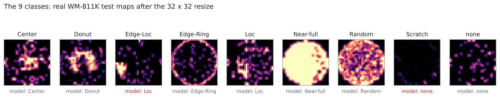
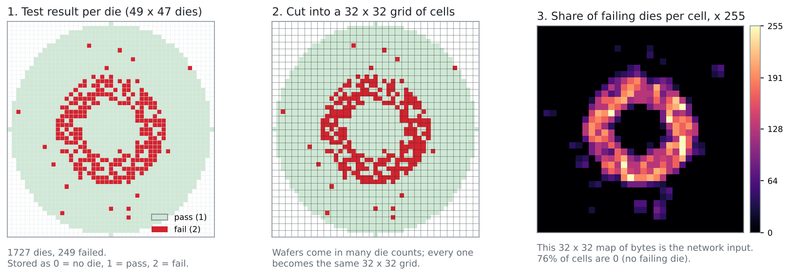
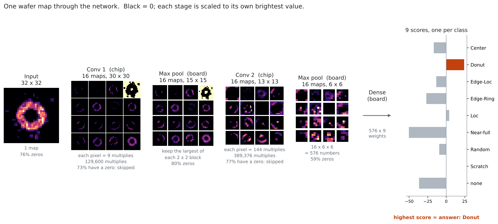
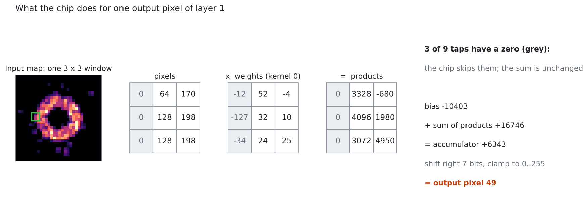

# From a wafer to a defect class

This page follows one wafer through the whole system: what the dataset holds, how a wafer becomes the
32 × 32 picture the network reads, what each layer turns it into, and how the last layer picks one of
nine defect classes. Every number in the figures comes from running the trained, 8-bit model through
`test/refmodel.py`, the bit-exact model of what the chip computes.

## The dataset: WM-811K

When a wafer comes out of the fab, every die on it is tested electrically, and the result is a map of
which dies passed and which failed. Where the failures sit says what went wrong in the process: a ring
at the edge, a blob in the center and a scratch line each have different causes.

WM-811K holds 811,457 such maps from real production. Engineers
labeled 172,950 of them with one of nine classes; the rest are unlabeled and not used here. Each map is
a grid with one cell per die position, holding one of three values:

| Value | Meaning |
| --- | --- |
| 0 | No die here (outside the round wafer) |
| 1 | Die passed |
| 2 | Die failed |

Products differ in die size, so the grids differ in size too.



*One real test map per class, after the resize described next. The model gets 7 of these 9 right; the
two misses (red) are the hardest classes, Edge-Loc against Loc and faint Scratch lines against none.*

## From dies to a 32 × 32 picture

The chip and the network need every wafer to be the same size, so each map is cut into a 32 × 32 grid of
cells, and each cell gets one byte: the share of its dies that failed, times 255. A cell with no failing
die is exactly 0. The code is `to_fail_grids()` in `model/prepare_data.py`.



*The example is a generated Donut map in WM-811K's format (`model/make_synthetic.py`), used because its
whole die grid fits on the page. 1,727 dies become 1,024 cells; three quarters of them are 0.*

Those zeros matter. A cell is 0 wherever no die failed, which is most of a typical wafer, and that is
where the chip's savings start.

## Layer by layer

| Stage | Output | Multiplies | Runs on |
| --- | --- | --- | --- |
| Input | 1 map, 32 × 32 | | |
| Convolution 1: 16 kernels, 3 × 3 | 16 maps, 30 × 30 | 129,600 | chip |
| Max pool, 2 × 2 | 16 maps, 15 × 15 | | board |
| Convolution 2: 16 kernels, 3 × 3 × 16 | 16 maps, 13 × 13 | 389,376 | chip |
| Max pool, 2 × 2 | 16 maps, 6 × 6 = 576 numbers | | board |
| Dense | 9 scores | 5,184 | board |

The chip does 518,976 of the 524,160 multiplies for one wafer, 99%. The board does the cheap rest.



**Convolution 1.** Each of the 16 kernels is a 3 × 3 grid of learned weights. It slides over the input
one cell at a time; at each position, the nine pixels under it are multiplied by its nine weights and
added up, and the sum (shifted down and clamped to 0..255) becomes one pixel of that kernel's output map.
Each kernel learns to respond to a small shape: an edge, a curve, a filled patch. In the figure, several
kernels already light up along the ring. 3 × 3 windows fit 30 × 30 times into a 32 × 32 map, so each
output map is 30 × 30. Clamping negative sums to 0 is the ReLU, and it creates more zeros.

**Max pool.** The board keeps the largest value in each 2 × 2 block, halving each map to 15 × 15. It
keeps "this shape appeared around here" while dropping the exact position.

**Convolution 2.** Now each output pixel looks at a 3 × 3 window in all 16 maps at once: 144 multiplies,
sent to the chip as 16 groups of nine that add into the same accumulator. Its kernels combine the simple
shapes from layer 1 into larger ones, like arcs and rings.

**Max pool again** leaves 16 maps of 6 × 6: 576 numbers that summarize the wafer.

**Dense.** For each class, the board multiplies all 576 numbers by that class's 576 learned weights and
adds them: nine weighted sums, nine scores. The highest score is the answer. The scores are not
probabilities; a softmax would turn them into probabilities, but picking the largest doesn't need it.

## What the chip does for one pixel



This is one `COMPUTE` command. The host has preloaded the kernel's bias into the accumulator
(`LOAD_ACC`) and its nine weights (`WRITE_WEIGHTS`), then sends the nine pixels. Three of the nine taps
have a zero pixel, so their products are zero and adding them changes nothing. The chip notices the zero
and holds the multiplier's inputs still for that tap instead of letting them switch, which is where the
power saving comes from, and it counts the tap in its skip counter. `READ_RESULT` shifts the accumulator
right, clamps it to 0..255, and returns the output pixel.

Across this wafer, 73% of layer-1 taps and 77% of layer-2 taps have a zero pixel or a zero weight. Over
the whole test set, 77% of the chip's multiplies have a zero operand.

## Redrawing the figures

```
python model/make_synthetic.py --n 6000 --out synthetic.pkl
python model/export_demo_data.py ...            # see model/README.md; writes demo_data.npz
python docs/figures/make_figures.py --weights demo_data.npz --wafers synthetic.pkl
```
